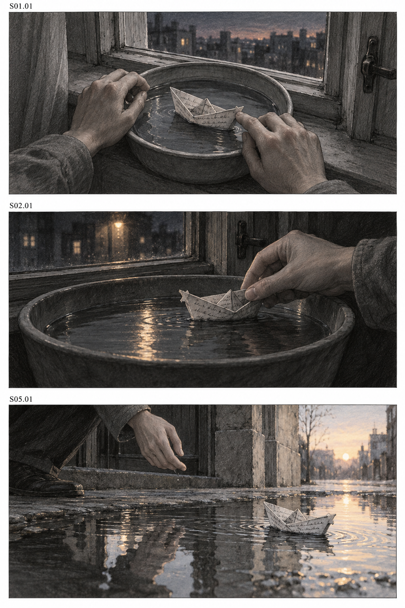

# MV Script

An Agent Skill for developing original music video concepts, complete scene scripts, character sheets, scene backgrounds, shot tables, and storyboard images from songs, lyrics, reference videos, and character images.

[中文说明](README.md) · [Skill](mv-script/SKILL.md) · [Validation](docs/validation.md) · [MIT](LICENSE)

## What it does

Start with any available input. The default workflow examines accessible sources, proposes two or three distinct concepts, and waits for a selection. A selected concept or an explicit request can proceed directly to a complete script. Shot tables are created only when requested.

When a reference video is provided, its section structure, editing pace, action beats, pauses, and climax organization guide the new work. These relationships are mapped to the target song, with timing changes explained. Original stories can share the reference structure while differing in character choices or conceptual mechanisms.

Deliverables include editable text and optional generated character sheets, scene backgrounds, and storyboard images. Image generation uses the host's available built-in tool without a separately configured API key; it is not guaranteed to run offline. The skill does not generate music or final videos, or submit video generation jobs.

## Install

```sh
git clone https://github.com/clemzychen14/mv-script.git
cd mv-script
python3 install_skill.py
```

The Codex destination is `~/.agents/skills/mv-script/`. Existing installations are inspected and backed up, with SHA256 verification before replacement. Backups live outside the skill discovery directory. No global configuration is changed.

For the standard Claude Code skill directory:

```sh
python3 install_skill.py --host claude
```

You can also copy the inner `mv-script/` directory into a project's `.agents/skills/`. Preserve an existing installation first. Claude Code execution has not been tested on a live installation.

## Use

Mention `$mv-script` or select MV Script in a compatible host:

```text
Use $mv-script to follow this reference video's structure and rhythm, combine it with my song and character images, and propose three original MV concepts first.
```

Continue with a selected direction, request a complete scene script, or ask for a storyboard. Revision requests can be limited to a specific scene, character, or chorus while preserving confirmed material elsewhere.

The workflow adapts to the input. Lyrics alone support concepts and an ordered script; readable images support visible character or scene descriptions. Missing audio evidence is marked as unknown rather than replaced with invented BPM, song sections, or lyric timestamps. Shot counts and durations are not fixed to a grid or a 15 second segment rule.

## Character sheets and scene backgrounds

A polished character sheet is not required at the start. A clear photograph, illustration, partial view, or several detail references can be used, and materials can arrive gradually. Request only the assets needed for the current task. Existing usable images can be referenced directly.

```text
Create a front, side, and back character sheet from this reference. Preserve the visible face design, hair, outfit, colors, and accessories. Identify unseen details as creative additions.

Create an unoccupied background from this scene reference, preserving its visible layout, materials, and lighting. Identify reconstructed occluded areas.

Use the selected character sheet and background as image references for the storyboard.
```

Character sheets preserve visible anchors while treating unseen views as proposed design, not recovered facts. Background requests can retain the original setting, develop a new one from its style, or create requested camera and lighting variants. Generated files, reference roles, selected versions, and creative additions are recorded under `assets/characters/`, `assets/scenes/`, and `assets/index.md`. Later storyboard calls pass the actual selected images to the image tool.

The workflow does not require every missing asset to be generated before concepts or scripts can proceed. See the [visual asset workflow](mv-script/references/visual-assets.md). The [tested examples](examples/visual-assets/index.md) include a three-view sheet generated from one synthetic front image and an unoccupied background generated from the original storyboard. They record visible anchors, creative completions, and inspection limits.

## Storyboard images

After a shot table is confirmed, ask for storyboard images. You can also explicitly authorize a current draft directly. Generate individual shots or multi-panel pages, preserving character appearance, wardrobe, props, spatial direction, and the shot IDs. Panel count follows the content and does not require a nine-panel grid.

```text
Generate storyboard images from this shot table. Keep the character and scene details consistent, group shots by scene, and provide the actual images with a shot index.
```

The workflow calls an available image tool, inspects the results, and saves real image files under the project's `storyboard_images/` directory. It does not stop at prompts or placeholder cards. A full set is completed when requested, while preview requests stay limited to the requested scope. If no image tool is available, that limitation is reported. See the [image workflow](mv-script/references/storyboard-images.md). Only necessary text and image references are supplied to the image tool; full audio or video files are not additionally uploaded.

The following three-panel test page was actually generated and visually inspected from the original example, covering S01.01, S02.01, and S05.01. It is not aligned to a real song. See the [image index](examples/storyboard-images/index.md) for inspection limits and the saved prompt.



## Optional local tools

The writing workflow needs no media utilities. The optional helper uses Python 3.9 or newer, with FFprobe and FFmpeg when already available. PCM WAV duration can fall back to Python's standard library.

```sh
python3 mv-script/scripts/inspect_media.py --check-tools
python3 mv-script/scripts/inspect_media.py song.wav reference.mp4 --output mv_project/media_inspection
```

The helper reads metadata and extracts bounded sparse frames. It does not understand audio or images, estimate BPM, identify song sections, transcribe lyrics, or detect cuts. Temporal claims require continuous evidence, verified cuts, or clearly attributed user annotations. Sparse frames alone do not establish editing rhythm or camera movement.

File count, frame count, output size, and subprocess timeouts are bounded. URLs and nonempty output directories are rejected. Source files are not overwritten or deleted. See the [tool reference](mv-script/references/local-tools.md).

## Examples and validation

[Original test lyrics](examples/lyrics.txt), a [scene script](examples/screenplay.md), a [storyboard](examples/storyboard.md), and a [limited revision](examples/screenplay-revision.md) illustrate the workflow. They have not been aligned to a real song.

```sh
python3 -m pip install -r requirements-dev.txt
python3 validation/check_package.py
python3 validation/test_inspect_media.py
```

Twelve local media checks have passed using synthetic audio and video. Configuration, relative references, backup installation, and source preservation have also been checked. Real song and reference MV interpretation, precise lyric alignment, and live Claude Code invocation remain untested. GitHub Actions runs the repository checks; its actual results are recorded in the Actions tab.

The installable skill is the inner `mv-script/` directory. Examples, documentation, and development checks remain outside it. Generated media and local reports containing workstation paths are excluded from version control.
