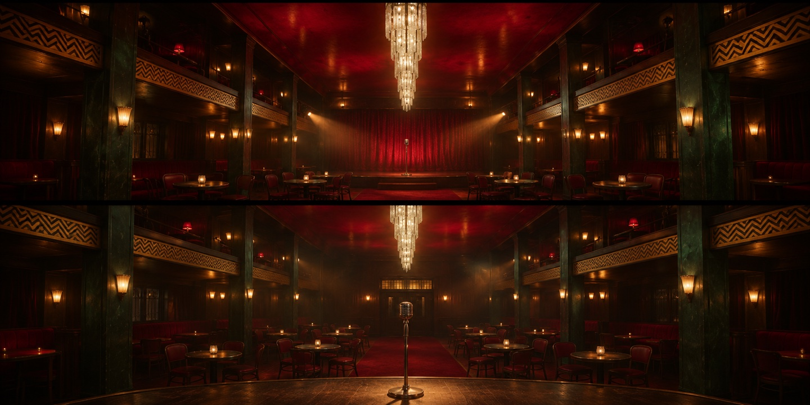
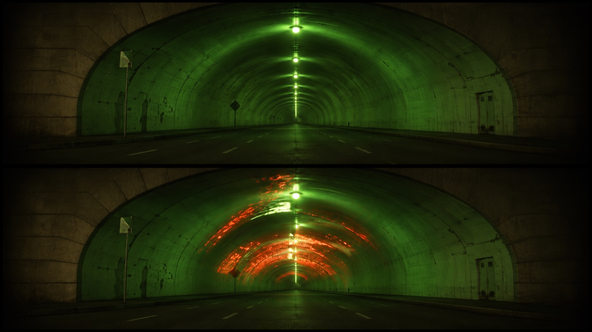
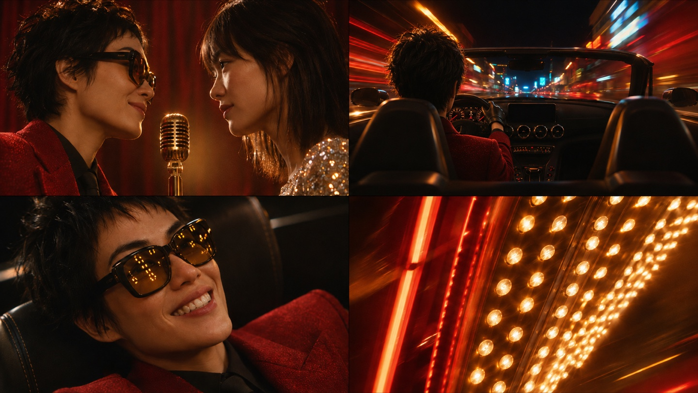
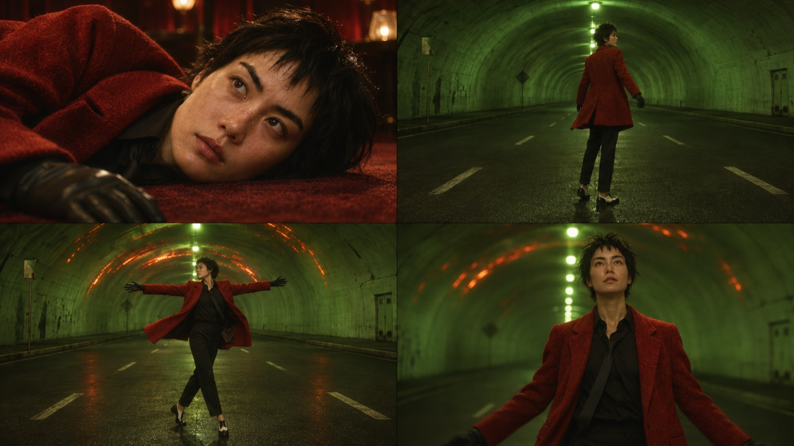

# MV Script

An Agent Skill for developing original music videos from songs, lyrics, and visual references. The workflow covers concepts, scripts, visual assets, storyboards, timed still-frame previews, and prompt packages for production.

[中文说明](README.md) · [Skill](mv-script/SKILL.md) · [Validation](docs/validation.md) · [MIT](LICENSE)

## What it does

Start with any available input. The default workflow examines accessible sources, proposes two or three distinct concepts, and waits for a selection. A selected concept or an explicit request can proceed directly to a complete script. Shot tables are created only when requested.

When a reference video is provided, its section structure, editing pace, action beats, pauses, and climax organization guide the new work. These relationships are mapped to the target song, with timing changes explained. Original stories can share the reference structure while differing in character choices or conceptual mechanisms.

In the full workflow, the script establishes the visual assets before storyboarding. The storyboard frames are then edited against the song to check timing. The adopted timing informs the per-clip prompts, settings, and references in the production handoff package.

## Install

```sh
git clone https://github.com/clemzychen14/mv-script.git
cd mv-script
python3 install_skill.py
```

The Codex destination is `~/.agents/skills/mv-script/`. Existing installations are inspected and backed up, with SHA256 verification before replacement. Backups live outside the skill discovery directory. No global configuration is changed.

For the standard Claude Code skill directory:

```sh
python3 install_skill.py --host claude
```

You can also copy the inner `mv-script/` directory into a project's `.agents/skills/`. Preserve an existing installation first. Claude Code execution has not been tested on a live installation.

## Use

Mention `$mv-script` or select MV Script in a compatible host:

```text
Use $mv-script to follow this reference video's structure and rhythm, combine it with my song and character images, and propose three original MV concepts first.
```

Continue with a selected direction, request a complete scene script, or ask for a storyboard. Revision requests can be limited to a specific scene, character, or chorus while preserving confirmed material elsewhere.

The workflow adapts to the input. Lyrics alone support concepts and an ordered script; readable images support visible character or scene descriptions. Missing audio evidence is marked as unknown rather than replaced with invented BPM, song sections, or lyric timestamps. Shot counts and durations are not fixed to a grid or a 15 second segment rule.

Each new MV defaults to its own folder under `mv_project/`. When asked to organize existing projects, the skill maps files to their projects, moves them into sibling folders, verifies affected references, and updates the project index. [Project organization](mv-script/references/project-organization.md)

## Visual assets

You can start with a clear photograph, an illustration, or partial views and add materials as you go. Once the script is settled, identify the three-view character sheets, separate face close-ups, key props, and scene images the shots will need. Adopt usable references and create the missing images required by the script.

```text
Create a front, side, and back character sheet from this reference. Preserve the visible face design, hair, outfit, colors, and accessories. Identify unseen details as creative additions.

Create an unoccupied background from this scene reference, preserving its visible layout, materials, and lighting. Identify reconstructed occluded areas.

Use the selected character sheet and background as image references for the storyboard.
```

Character sheets preserve visible anchors while treating unseen views as proposed design, not recovered facts. Background requests can retain the original setting, develop a new one from its style, or create requested camera and lighting variants. Generated files, reference roles, selected versions, and creative additions are recorded under `assets/characters/`, `assets/scenes/`, and `assets/index.md`. Later storyboard calls pass the actual selected images to the image tool.

[Visual asset workflow](mv-script/references/visual-assets.md)

## Storyboard images

After a shot table is confirmed, ask for storyboard images. You can also explicitly authorize a current draft directly. Generate individual shots or multi-panel pages, preserving character appearance, wardrobe, props, spatial direction, and the shot IDs. Panel count follows the content and does not require a nine-panel grid.

```text
Generate storyboard images from this shot table. Keep the character and scene details consistent, group shots by scene, and provide the actual images with a shot index.
```

The workflow calls an available image tool, inspects the results, and saves real image files under the project's `storyboard_images/` directory. It does not stop at prompts or placeholder cards. A full set is completed when requested, while preview requests stay limited to the requested scope. If no image tool is available, that limitation is reported. See the [image workflow](mv-script/references/storyboard-images.md). Only necessary text and image references are supplied to the image tool; full audio or video files are not additionally uploaded.

## Still-frame edit

Place individual storyboard frames on a timeline with the target song. Use the playable preview to review shot lengths, cuts, pauses, and the climax. Record adopted changes in the shot timeline for the prompt and handoff stages. See the [still-frame editing workflow](mv-script/references/still-frame-edit.md).

## Optional local tools

The writing workflow needs no media utilities. The optional helper uses Python 3.9 or newer, with FFprobe and FFmpeg when already available. PCM WAV duration can fall back to Python's standard library.

```sh
python3 mv-script/scripts/inspect_media.py --check-tools
python3 mv-script/scripts/inspect_media.py song.wav reference.mp4 --output mv_project/demo/media_inspection
```

The helper reads metadata and extracts bounded sparse frames. It does not understand audio or images, estimate BPM, identify song sections, transcribe lyrics, or detect cuts. Temporal claims require continuous evidence, verified cuts, or clearly attributed user annotations. Sparse frames alone do not establish editing rhythm or camera movement.

File count, frame count, output size, and subprocess timeouts are bounded. URLs and nonempty output directories are rejected. Source files are not overwritten or deleted. See the [tool reference](mv-script/references/local-tools.md).

## 《催眠》 MV short-cut case study

### Adapting the reference structure

The short cut uses the updated version of 《催眠》 from start to finish at its original speed. Its eight sections follow the reference through a lit arcade, a night drive, a red stage, a moment of levitation and eye contact, a confrontation, a green tunnel, and a city finale. The arcade and driving sequences use fewer shots to leave time for the character to approach the stage and for the full turn and arm extension in the tunnel. Her smile in the opening close-up returns in the finale after the confrontation.

In section 5, from 00:29.00 to 00:55.12, the protagonist rises from her chair and glides toward the stage. The singer reaches out, and the two hold each other's gaze. At 00:48.00, the edit moves from their faces to streaking lights inside the car, then to the driver's smile behind sunglasses and a rush of red and gold lights. That sequence follows the reference at approximately 02:25 to 02:30. The edit returns to the red hall at 00:55.12 as the encounter is interrupted.

### Selecting visual assets

| Asset | Purpose |
| --- | --- |
| C01 protagonist | The front, side, and back views guide proportions and red-and-black wardrobe. The supplied front-facing photo anchors her identity, with additional angles for comparison. The character state sheet tracks her sunglasses, collar, and abrasion. |
| P01 personal items and V01 silver convertible | The item references track sunglasses, gloves, and wardrobe details. The silver exterior and black interior carry through the roadside, driving, and return shots. |
| E03 red hall and E04 green tunnel | The hall reference establishes the layout of the curtains, tables, chairs, and stage. The tunnel reference establishes the overhead lights, arch depth, and red-orange highlights. |

| E03 red hall, stage and reverse views | E04 green tunnel, base and effect lighting |
| --- | --- |
|  |  |

### Storyboard and still-frame edit

| Shot | Time in the full edit | Action and cut |
| --- | --- | --- |
| S05.05 | 00:44.32 to 00:48.00 | Hold on the two characters' gaze in profile before cutting to the lights inside the car. |
| S05.06 | 00:48.00 to 00:50.44 | Start the return to the night drive with light trails seen from inside the car. |
| S07.02 | 01:11.52 to 01:20.56 | Give the turn, arm extension, cross-step, and weight shift 9.04 seconds in one medium-wide shot. |
| S08.03 to S08.04 | 01:33.40 to 01:40.60 | Cut on the same reaching gesture from a close view to a low-angle full-body shot at 01:37.20. |

The storyboard reuses panels where the composition still fits and adds frames for the short cut. Section 5 has two storyboard pages and a 26.12-second still-frame preview. The full-song revision expands the city finale to six shots while keeping the earlier shot order and the original-speed audio. The revised edit has 34 shots and 33 cuts, with 2,705 frames at 25 fps (108.20 seconds) against 108.191625 seconds of audio.



*Read left to right, top to bottom. The cut moves from eye contact in the red hall to the car's light trails, the smile behind sunglasses, and the red and gold light array.*

### Preparing the generation handoff

The handoff package contains a shot execution table, per-shot prompts, input order, and the actual reference files. For S07.02, the 9.04-second excerpt from 01:11.52 to 01:20.56 starts at zero in the clip's WAV file.



*The lower-left panel shows S07.02 at the arm extension and cross-step.*

| Input | Role |
| --- | --- |
| Image 1 | The supplied front-facing photo anchors the protagonist's face. |
| Images 2, 3, and 4 | Show the opening pose, the arm extension and cross-step, and the return to a forward-facing stance. |
| Video 1 | Provides the shoulder-led turn and arm extension as motion reference. |
| Audio 1 | Contains the excerpt for this shot at its original speed. |

The Wan3 PE prompt calls for a continuous medium-wide shot with a gentle lateral camera move and room for the hands and feet. The shifted tie, absent sunglasses, and dry abrasion carry through the shot. The still-frame preview, execution table, and input package are complete. Performance, motion continuity, and lip sync remain to be checked on generated footage.

## Validation

```sh
python3 -m pip install -r requirements-dev.txt
python3 validation/check_package.py
python3 validation/test_inspect_media.py
```

Twelve local media checks have passed using synthetic audio and video. Configuration, relative references, backup installation, and source preservation have also been checked. The 《催眠》 case study records the checks performed on its still-frame edit and handoff package. [Validation](docs/validation.md)

The installable skill is the inner `mv-script/` directory. Repository documentation and development checks remain outside it. Generated media and local reports containing workstation paths are excluded from version control.
