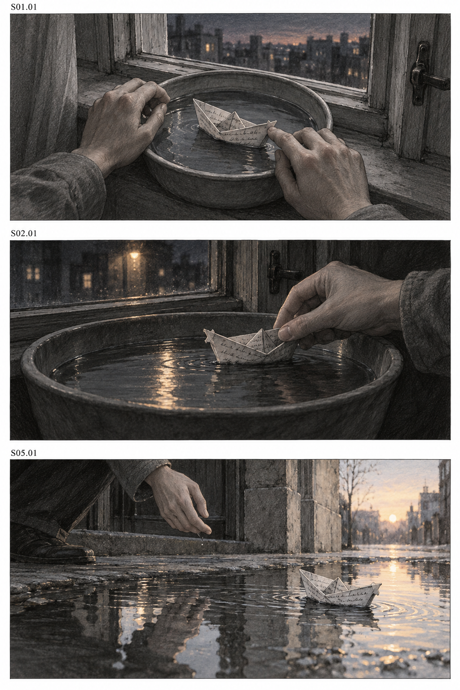

# Music Video Script Writing - 音乐MV剧本分镜生成

根据歌曲、歌词、参考视频与角色图片，逐步开发原创 MV 概念、完整剧本、角色设定图、背景图与分镜图的 Agent Skill。

[English](README.en.md) · [安装说明](INSTALL.md) · [技能入口](mv-script/SKILL.md) · [验证范围](docs/validation.md) · [MIT](LICENSE)

## 用它做什么

MV Script 面向音乐视频的前期创作。你可以从一首歌、几句歌词、一段参考视频或一张角色图开始，不必一次备齐所有素材。默认先分析可读取的内容，提出 2 至 3 个不同的创意方向；选定方向后扩写成场次级剧本，需要时再做导演分镜。

有参考视频时，优先参照它的段落结构、剪辑快慢、人物动作节拍、重要停顿和高潮安排，再与目标歌曲对应。不同歌曲或时长会重新安排时间，并说明保留和调整之处。多个创意方向可以共享参考骨架，通过人物选择、概念机制和视觉事件形成差异。

产出包括可编辑文本，以及按需生成的 character sheet、场景背景与静态分镜图。出图优先使用宿主内置图像工具，无需单独配置 API Key；图像能力由宿主提供，不承诺全离线生成。本技能不生成音乐或最终视频，不提交视频生成任务。

## 输入与产出

| 输入 | 可开展的工作 |
| --- | --- |
| 本地音乐 | 读取可得时长和参数，结合实际听辨或用户描述建立音乐叙事地图 |
| 歌词、LRC、SRT | 分析主题、意象、重复及叙事张力；保留时间信息的来源与核验状态 |
| 参考视频 | 分析可见画面，提取有证据支持的结构与节奏关系，映射到新方案 |
| 角色或场景图片 | 建立设定卡，按需生成角色 character sheet、场景背景或其他视角，单独标注创作补全 |
| 文字要求或已有剧本 | 创意开发、扩写、按需分镜及限定范围的修订 |

可以只用其中一种输入。没有可靠音频或时间轴时，使用段落顺序与待确认标记，不编造 BPM、歌词入点或精确镜头秒数。

## 安装

克隆仓库后运行本地安装器：

```sh
git clone https://github.com/clemzychen14/mv-script.git
cd mv-script
python3 install_skill.py
```

Codex 默认安装到 `~/.agents/skills/mv-script/`。已有同名技能时，安装器先检查、备份并核对 SHA256，再替换；备份位于技能发现目录之外。安装器不会修改全局配置。

安装到 Claude Code 的标准技能目录：

```sh
python3 install_skill.py --host claude
```

也可以手动把仓库中的 `mv-script/` 文件夹放进项目的 `.agents/skills/`。安装前保留已有同名目录。Claude Code 的实际调用尚未实机验证。

## 最简使用

在支持技能提及的输入框中选择 MV Script，或使用 `$mv-script`：

```text
使用 $mv-script，参考这段视频的结构和节奏，结合这首歌与角色图，先给我三个原创 MV 创意方向。
```

选定方向后继续：

```text
把第二个方向扩写成完整的场次级 MV 剧本，保持参考视频的节奏推进。
```

需要分镜时明确提出：

```text
把已确认剧本转成导演分镜。注明参考段落和时间依据，未对齐的部分保留待确认标记。
```

也支持仅歌词、仅角色分析和局部修订：

```text
我只有歌词，先给两个不同的概念，不写分镜。

先分析这张角色图，区分可见特征与新增设定。

只修改第二次副歌的视觉叙事，保持角色与其他场次不变。
```

## 工作方式

| 阶段 | 主要工作 | 何时停止 |
| --- | --- | --- |
| 素材与能力检查 | 确认可访问内容、分析能力和证据限制 | 仅要求分析时，在所需分析完成后停止 |
| 角色与场景资产 | 从参考图片生成角色设定图、背景图并检查 | 按需执行，不要求事先备好完整设定图 |
| 参考分析与创意 | 音乐叙事地图、参考结构映射、设定与不同概念 | 默认停在创意提案，等待选择 |
| 完整剧本 | 人物行动、场次发展、视觉主题、高潮与结尾 | 按选择或直接创作要求展开 |
| 导演分镜 | 动作、景别、运镜、光色、转场、作用及制作备注 | 仅在要求分镜时生成 |
| 分镜图 | 根据文字分镜实际出图，检查角色、场景与镜头对应 | 仅在要求图片时生成，支持单镜图与多格故事板 |
| 检查与修订 | 连续性、意象回收、音乐关系和指定范围修改 | 不自动重写已确认部分 |

镜头数量与长度依据音乐、参考节奏和叙事决定，不固定每 15 秒九个分镜。只生成当前阶段需要的内容，不预建大量空文档。

## 从参考图片补充角色与背景

不需要一开始就准备精修的 character sheet。清晰的照片、插画、半身图或几张局部参考都可以起步；人物与场景资料也可以稍后补充。

```text
我只有这张角色参考图。保持脸型、发型、服装和配色，生成正面、侧面、背面的 character sheet；看不到的细节作为创作补全单独说明。

根据这张场景参考生成无人背景图，保留窗门、材质和光色，人物遮挡的部分合理补全。

使用刚才采用的角色设定图和背景图继续生成分镜，保持角色与空间一致。
```

角色图保留可见的外貌与服装锚点；背面、未显示鞋履和遮挡处属于新增设计，不声称从参考恢复出了真实细节。背景可生成保留原场景的空背景、基于参考的新场景，或按需补充机位与光照版本。已合用的图片可以直接使用，不会为进入创意阶段强制补齐整套资产。

图片按角色或场景 ID 保存到 `assets/characters/`、`assets/scenes/`，并记录采用版本与补全说明。后续分镜实际引用这些图像，局部修改只同步受影响资产与镜头。详见 [角色与背景图规范](mv-script/references/visual-assets.md)。

已经实际使用单张合成角色图生成三视图，并从原创分镜生成无人背景。结果、原图与补全说明见 [角色与背景图示例](examples/visual-assets/index.md)。

## 分镜图生成

文字分镜确认后可以继续要求出图；也可以明确指定当前稿直接生成，不必再次确认同一范围。

```text
按这份文字分镜生成分镜图，保持角色外观、服装、道具和场景方向一致。按场次分页，不强制九宫格。

只修改 S03.02 的分镜图，保留其他画面与角色设定。
```

使用可用的宿主图像工具实际生成并查看结果，按镜头号保存到项目的 `storyboard_images/`，附上图片预览和镜头索引。用户要全套时连续完成；只要预览时生成对应范围。没有图像工具时明确说明限制并保留图像描述，不把提示词当成已生成图片。详见 [分镜图生成规范](mv-script/references/storyboard-images.md)。

下面是根据原创示例实际生成并查看的三格测试页，对应 S01.01、S02.01 与 S05.01。它未与真实歌曲对齐，检查结果及图像描述见 [图片索引](examples/storyboard-images/index.md)。



## 依赖与能力边界

文字创作只需要支持 Agent Skills 的宿主。图片与音频理解依赖宿主实际可用能力；角色设定图、背景图与分镜图生成还需要可用图像生成或编辑工具，本地辅助程序不会提供这些语义或出图能力。只向出图工具提供任务所需的文字和图片参考，不额外上传整段音视频。

可选媒体工具使用 Python 3.9 及以上和已安装的 FFprobe、FFmpeg。Python 标准库可在没有 FFprobe 时读取 PCM WAV 的样本时长。脚本限制输入数量、抽帧数量、输出大小与子进程运行时间，拒绝 URL 和非空输出目录。

```sh
python3 mv-script/scripts/inspect_media.py --check-tools
python3 mv-script/scripts/inspect_media.py song.wav reference.mp4 --output mv_project/media_inspection
```

辅助脚本只做元数据与有限抽帧，不自动识别音乐段落、估计 BPM、转录歌词或检测切镜。少量静帧不足以确定完整剪辑节奏或运镜。判断节奏时需要连续画面、经核验的切点或明确归于用户的标注。详见 [参考映射规范](mv-script/references/reference-structure-rhythm.md) 与 [本地工具说明](mv-script/references/local-tools.md)。

## 示例与验证

[原创测试歌词](examples/lyrics.txt)、[完整剧本](examples/screenplay.md)、[导演分镜](examples/storyboard.md) 和 [局部修订稿](examples/screenplay-revision.md) 展示同一方向如何逐步展开。这些是验收示例，不代表对真实歌曲完成了时间对齐。

运行检查：

```sh
python3 -m pip install -r requirements-dev.txt
python3 validation/check_package.py
python3 validation/test_inspect_media.py
```

已在本地使用合成音视频完成 12 项媒体测试，并验证格式、引用、备份安装和原素材保护。真实歌曲、真实参考 MV 的语义分析与 Claude Code 实际调用仍待验证。GitHub Actions 使用相同检查，结果以仓库运行记录为准。详见 [验证说明](docs/validation.md)。

## 目录

```text
mv-script/
    SKILL.md
    agents/openai.yaml
    references/
    scripts/inspect_media.py
    LICENSE
examples/
docs/validation.md
validation/
install_skill.py
INSTALL.md
```

`mv-script/` 是可安装技能，其他目录用于项目文档、示例与开发检查。测试现场生成的媒体、包含本机路径的报告及个人项目素材不纳入版本库。
