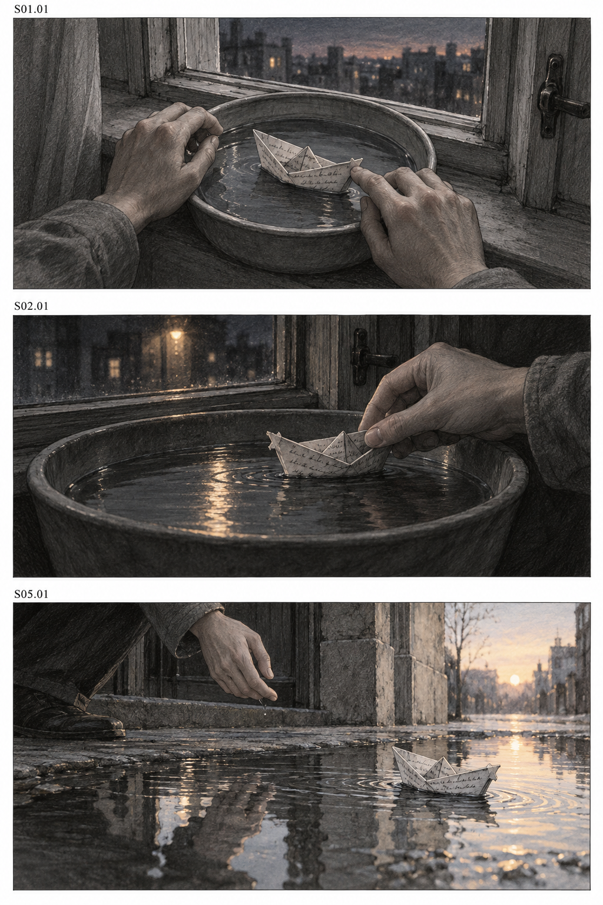

# 三格分镜图示例

采用 [原创试写剧本](../screenplay.md) 与 [文字分镜](../storyboard.md) 中的三个镜头，通过宿主内置 image_gen 工具实际生成静态故事板。角色外观属于创作设定，没有输入真实人物或用户角色照片。此页是功能测试示例，不代表用户已经确认该创意，也未与真实歌曲对齐。

| 图片 | 格位与镜头 | 关键画面 | 实际检查 |
| --- | --- | --- | --- |
| `page-01.png` | 上格，S01.01 | 窗边浅盘中的纸船与仍接触它的手 | 编号、两只手、纸船与窗边空间可读 |
| 同一页 | 中格，S02.01 | 夜间人物仍扶着纸船 | 镜头顺序、衣袖、浅盘与夜间光线可读；静态图不能证明拉回动作 |
| 同一页 | 下格，S05.01 | 门外浅水中纸船离开手，清晨光线 | 手与船已分离，外景区别于室内浅盘 |

已实际查看输出：三格完整，没有补足九宫格或使用空白占位；编号与文字分镜对应。画面采用低饱和铅笔质感，局部带暖色。纸船裂口及中格光带的严格跨镜细节仍需制作级精修，不将本次功能检查称为所有连续性细节都已通过。

生成描述保存在 [prompt.txt](prompt.txt)。后续修改应按镜头号指定范围，保留本页原稿。该图没有验证运镜、动作速度、唇形或音画同步。
