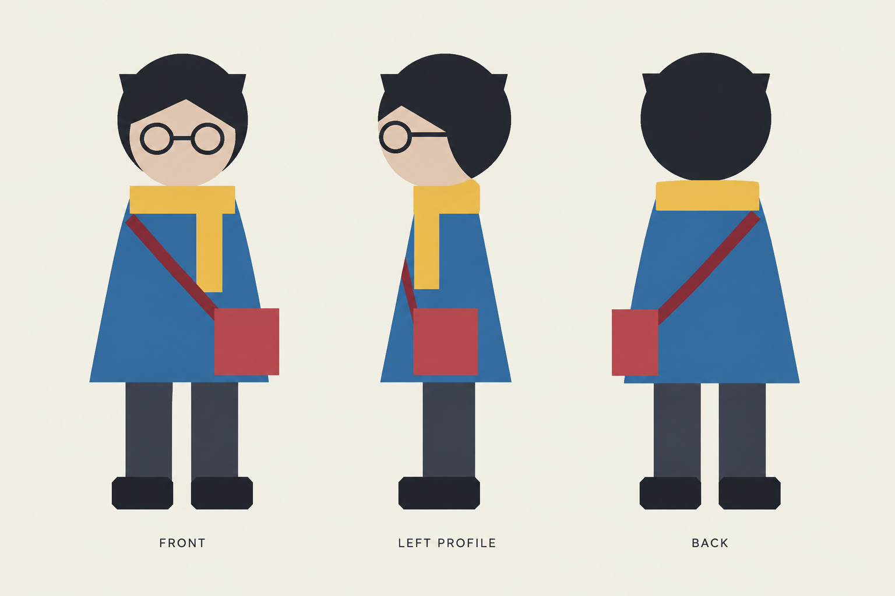

# 参考图片到角色设定图与背景图

这些是功能验证用的合成与原创素材，通过宿主内置 image_gen 实际传入参考图片、生成并查看结果。没有使用用户真人照片，不代表任何真实人物的多视角复原。图片为测试工作版本，未标记为用户已确认设定。

## C01 角色设定图

输入是本地测试程序绘制的 [单张正面角色图](reference-character.png)，不是预先制作的三视图。将其作为身份、服装、配色与插画风格参考，生成同一角色的正面、左侧面与背面。

实际检查：三视图编号与视角标签清楚，头顶及鞋完整；短深色发型、圆眼镜、蓝色外套、黄色围巾、深色裤鞋和红色斜挎包均保留。正面包在画面右侧、背面在画面左侧，符合包位于角色自身左侧的设定。整体采用原图的简化插画风格，局部增加轻微明暗。

原图没有展示背面和侧面。发型后部、外套背面、围巾转折与包带在新视角中的延续都属于创作补全。该结果适合作为后续视觉参考，不构成几何或三维模型验证。完整生成描述见 [character-sheet-prompt.txt](character-sheet-prompt.txt)。

## E01 无人背景

输入是先前生成的 [原创三格分镜](../storyboard-images/page-01.png)。只采用前两格的窗台、浅盘、窗框、右侧窗闩、材质与暮色，不把第三格的室外门口混入同一场景。

实际检查：输出为单幅横向背景，保留旧木窗、窗台、右侧窗闩、盛水浅盘与窗外模糊城市；人物、手臂、衣袖、纸船和镜头文字均已去除。原来被手遮挡的盘沿和木纹属于新补全。机位与局部纹理有生成差异，不称为原图精确复原。完整描述见 [background-prompt.txt](background-prompt.txt)。

## 资产映射

| ID | 输入用途 | 实际输出 | 版本与状态 | 后续用途 |
| --- | --- | --- | --- | --- |
| C01 | 单张合成正面插画，身份与造型参考 | `C01_sheet_v01.png` | v01，测试工作版本 | 角色外貌、服装、配色及包带方向参考 |
| E01 | 原创分镜前两格，空间与美术参考 | `E01_background_v01.png` | v01，测试工作版本 | 无人场景、构图、材质与光色参考 |

后续分镜应按采用版本读取并实际传入这些图像。此次验证覆盖两种参考图出图功能，没有另外生成同时使用这两项新资产的完整分镜序列。真实人像、半身图补全、多角色图归属与复杂场景改机位仍未实测。
